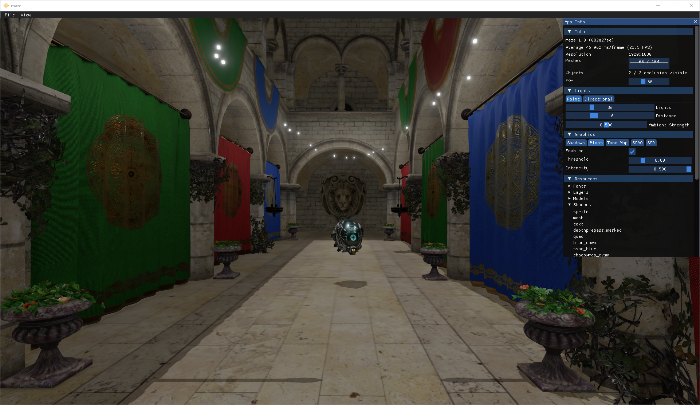

# Maze

A game engine featuring a nice walk through a maze.



## Features

* OpenGL and C++ for Windows and Linux
* Physically based rendering with glTF 2.0 materials, clear coat and diffuse transmission
* Point and directional lights with clustered light culling
* Exponential variance shadow maps
* Bloom, SSAO, screen-space and planar reflections, reflection probe, refraction
* AgX, ACES, Filmic or Reinhard tone mapping
* FXAA or temporal anti-aliasing
* Frustum and occlusion culling
* Shaders in Slang, compiled at build time into one pack
* Build-time asset converter: glTF models to an engine format, BC7 and BC5 textures in KTX2
* LCD subpixel text (FreeType, HarfBuzz) and Yoga flexbox UI that scales with the window
* Options screen for display, keyboard and audio, with key rebinding and gamepad support
* Audio with miniaudio
* Tracy profiling and Dear ImGui debug UI

## Project Organization

```
assets/          # game assets
docs/            # documentation
game/            # source files for maze
sponge/          # source files for sponge game engine
tools/           # tools and utility scripts, including the assetconv asset converter
```

## Getting Started

For instructions on how to build and run the application, see
the [full documentation](https://tomconder.github.io/maze/).
