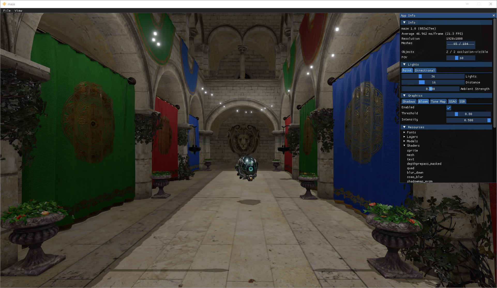

# Maze

A game engine featuring a nice walk through a maze.



## Features

* OpenGL and C++ for Windows and Linux
* Physically based rendering with glTF 2.0 materials, clear coat and diffuse transmission
* Point and directional lights with clustered light culling
* Exponential variance shadow maps
* Bloom, SSAO, screen-space and planar reflections, reflection probe, refraction
* AgX, ACES, Filmic or Reinhard tone mapping
* FXAA or temporal anti-aliasing
* Frustum and occlusion culling
* Shaders in Slang, compiled at build time into one pack
* Build-time asset converter, yeschef, written in Rust: glTF models to an engine format, BC7 and BC5 textures in KTX2
* LCD subpixel text (skrifa, HarfRust) and Yoga flexbox UI that scales with the window
* Options screen for display, keyboard and audio, with key rebinding and gamepad support
* Audio with miniaudio
* Tracy profiling and Dear ImGui debug UI

## Project Organization

```
assets/          # game assets
docs/            # documentation
game/            # source files for maze
sponge/          # source files for sponge game engine
tools/           # tools and utility scripts, including yeschef, the Rust asset converter
```

## Installing

Clone this repository.

```
git clone https://github.com/tomconder/maze.git
```

### Install vcpkg

> The `VCPKG_ROOT` environment variable must be set so that CMake can find vcpkg to install dependencies for the build.

[Install vcpkg](https://github.com/microsoft/vcpkg#getting-started), a dependency and package manager for C++.

By far the quickest way to install vcpkg is to clone it into this project.

```
cd maze
git clone https://github.com/microsoft/vcpkg.git
cd vcpkg
bootstrap-vcpkg.bat
cd ..
setx VCPKG_ROOT vcpkg
```

If you installed vcpkg elsewhere, add an environment variable called `VCPKG_ROOT` that contains the location where you
installed vcpkg.

```
setx VCPKG_ROOT <path to vcpkg>
```

### Install CMake

Use a package manager to install [CMake](https://cmake.org/), a cross-platform build system, on your platform.

For example, on Windows use [WinGet](https://learn.microsoft.com/en-us/windows/package-manager/winget/) to install
CMake.

```
winget install cmake
```

### Install Rust

The build compiles the yeschef asset converter with cargo, so it needs [Rust](https://rustup.rs/) and libclang (LLVM).

## Building

Use a configuration preset to compile `maze`. Possible values are:

| Preset                 | Description                          |
|------------------------|--------------------------------------|
| `ci-linux-debug`       | Linux debug build                    |
| `ci-linux-release`     | Linux release build                  |
| `ci-osx-debug`         | MacOS debug build                    |
| `ci-osx-release`       | MacOS release build                  |
| `ci-windows-debug`     | Windows debug build (uses sccache)   |
| `ci-windows-release`   | Windows release build (uses sccache) |
| `windows-clang-debug`  | Windows clang debug build            |
| `windows-clang-release`| Windows clang release build          |

To use the preset on Windows:

```
cmake.exe -B build --preset windows-clang-release
cmake.exe --build build --target game
```

## Running

On Windows, you can find the maze executable will be found in the build directory.

```
build\maze\maze.exe
```

Or, for MacOS, the app bundle will be found in the build directory.

```
build/maze/maze.app
```

Run `maze` from its own directory. It loads its assets from a path that is relative to the working directory. From any
other directory no assets load and the window stays grey.

Debug builds also take capture flags that render a fixed run, or one menu screen at any window size, and write the
results to files. See [Capture flags](capture.md).
